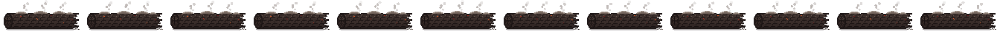

# GeeGeeKing


> 一个 2D 像素风的桌面待办小工具。每一条待办都是一根木头：截止时间越近，火烧得越旺；逾期化为灰烬，完成后浇水，让它重新长出新芽。

项目目前处于开发准备阶段，尚未发布安装包。已经确定的产品范围见 [PRD.md](PRD.md)，尚未确认的问题也集中记录在那里。

## 动画风格

默认风格是**燃烧的木头**：事项名称直接显示在木头上，动画也直接作用在木头上。

| 状态 | 表现 |
| --- | --- |
| 不急 | 普通木头，带着微风嫩叶和漂浮光尘 |
| 急 | 木头上的火焰变大，火星四溅 |
| 急死了 | 整根木头猛烈燃烧，火花与爆裂星芒加剧 |
| 逾期 | 火焰熄灭，木头变成焦木与灰烬 |
| 浇水 | 水浇灭火焰，蒸汽升起 |
| 完成 | 灭火之后长出绿芽与小花 |

### 素材雪碧图

下面直接展示当前 V4 木头素材的原始雪碧图。每张 PNG 包含 12 帧，静态展示的是完整帧序列。GitHub 不会直接运行 HTML；把素材包下载到本地后，双击 [preview.html](GeeGeeKing-wood-v4/preview.html) 用浏览器打开，即可查看动画，并点击木头体验「浇水 → 绿芽」。

| 状态 | 雪碧图 |
| --- | --- |
| 不急 |  |
| 急 |  |
| 急死了 |  |
| 逾期 |  |
| 浇水 |  |
| 完成 |  |

## 功能范围

- 只做一件事：新增待办事项。
- 每条事项只有两个字段：事项名称、截止时间。
- 事项按截止时间排序展示。
- 根据剩余时间切换紧迫度状态，不同状态播放不同的 2D 像素动画。
- 支持窗口置顶，让待办始终显示在其他窗口上方。
- 数据只保存在当前电脑上，不登录、不联网、不做多设备同步。

## 后续风格

以下方向已经确定，但当前版本不实现：

- **引线炸弹**：引线随剩余时间变短，急死了时末端火花狂闪；完成就是剪断引线。
- **头上着火的小人**：不急时睡觉冒 Zzz，急时快步走，急死了时头顶着火狂奔；完成后擦汗喝水。
- **冰块融化**：越接近截止化得越多，急死了时只剩一小块在晃；完成后重新冻成冰雕。
- **蜡烛**：随时间真的烧短，急死了时火苗狂闪将灭。
- **气球**：不断充气变大，逾期时爆掉。

## 技术栈

| 用途 | 选择 | 说明 |
| --- | --- | --- |
| 桌面端框架 | Tauri 2 | 窗口置顶、无边框窗口等桌面能力 |
| 前端框架 | React + TypeScript + Vite | 界面与动画都在前端实现 |
| 数据存储 | 本地 JSON 文件 | 数据只保存在当前电脑上 |

应用标识为 `com.gegeeking.app`，显示名称为 `GeeGeeKing`。最终产物是 Windows 安装包，不需要部署服务器。

## 开发

工程初始化后，需要准备以下环境：

- Windows 10 / 11
- Node.js 与 npm
- Rust（rustup）
- Visual Studio C++ 生成工具
- WebView2 运行时（Windows 11 已内置）

```bash
npm install
npm run tauri dev
```

打包安装包：

```bash
npm run tauri build
```

## 项目文档

- [PRD.md](PRD.md)：产品需求、已确定的功能、待确认的问题。
- [GeeGeeKing-wood-v4/README.md](GeeGeeKing-wood-v4/README.md)：木头素材说明与接入示例。
- [GeeGeeKing-wood-v4/preview.html](GeeGeeKing-wood-v4/preview.html)：可离线打开的木头动画预览。
